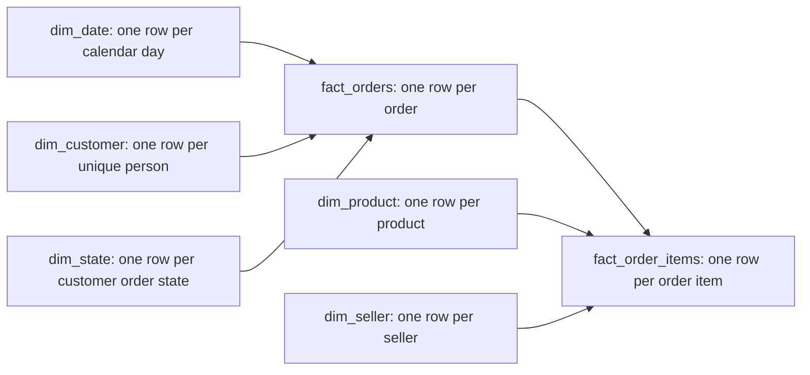

# CommerceLens: E-Commerce Revenue & Retention Analytics

## Delivery status and evidence

This package contains a native Power BI project, not a PBIX binary. The project includes four presentation pages and two hidden support pages, an Import semantic model, Power Query transformations, 41 DAX measures, a theme, and reproducible validators. **Draft until Desktop refresh and visual/interaction testing are complete.** Source reconciliation is computed independently in Python from the nine supplied CSV files. Schema validation and TOM parsing do not execute M, compile DAX, or prove visual rendering.

Open `CommerceLens.pbip` in Power BI Desktop. Both sibling folders (`CommerceLens.Report` and `CommerceLens.SemanticModel`) must stay next to it. The project uses Microsoft's PBIR report format and a supported JSON semantic model (`model.bim`). No data is published or uploaded by the build scripts.

## Business contract

Revenue is **item price plus freight**, across all order statuses unless the user filters status. It represents gross order value, not recognized accounting revenue or net revenue after refunds. Olist provides no refund ledger, margin, acquisition spend, or reliable cancelled-order reversal amount. This deliberately differs from the repository's earlier Streamlit definition (delivered item price, excluding freight). There is no currency conversion: all amounts are Brazilian reais.

Orders counts one row per order, including orders without item lines. AOV divides selected item revenue by matching order count. When a category is selected, AOV is selected-category spend per matching order, not the full basket AOV. Category order counts overlap when an order includes several categories; totals count distinct orders rather than summing category order counts.

Delivery and review measures intersect current status selection with `delivered` using KEEPFILTERS. Selecting a non-delivered status produces blank/zero delivery results rather than silently replacing the slicer. Dates refer to purchase date, including delivery/review analyses, so these are purchase cohorts rather than delivery-month cohorts.

Late means `Date.From(delivered timestamp) > Date.From(estimated timestamp)`. The promised timestamp is a date at midnight; comparing full timestamps would incorrectly label same-day arrivals late. Missing dates are not on-time. Lateness denominator includes only delivered orders with both dates. Review denominator includes only delivered orders with a latest valid 1–5 score. Cohort comparisons also require known lateness.

## Model and relationships

All six relationships are active, single-direction, one-to-many from dimension/parent to fact/child. No bidirectional or many-to-many relationships exist. The order-header / item-detail extension is necessary: a single order may contain multiple products and sellers. Joining their keys into one order row would either lose information or multiply order revenue. Customer state filtering uses the address on each order, through dim_state; dim_customer city/state records the latest observed address and is not the geography slicer.

Product and seller dimensions filter item rows. Order-grain measures explicitly transfer the resulting distinct order IDs using TREATAS only when product or seller filtering exists. Without those filters, orders lacking item rows remain included. Date and customer filters flow through the order header to its items. Revenue always sums the item fact; payment totals are aggregated separately and never joined at raw payment × item grain.

`dim_date` covers complete calendar years from the first through last purchase year, with a unique non-null Date key and model Time metadata. Date is marked through `dataCategory=Time` and `isKey=true`; verify Desktop recognizes it under Mark as date table. Month name sorts by month number. Week is Power Query week-of-year with Monday start, **not an ISO week-year**. Auto date/time is disabled in model annotations. Keys and unused fact fields are hidden; seller ID remains available to the authored table even though hidden from general field browsing. All descriptive attributes and bins are produced in Power Query, not DAX calculated columns.

All 41 measures live on `fact_orders` (Power BI Desktop reserves the table name `Measures`). Disconnected tables: `Late Reduction %` (0–1 in 0.05 steps), `Scenario` (Before/After). `cleaning_log` is a hidden audit table and has no relationships.

## RFM segmentation

RFM is a static refresh-time snapshot as of **2018-10-18**, one day after the last observed purchase. It uses delivered purchases only; recency is days since last delivered purchase, frequency is delivered order count, monetary is delivered price plus freight. Median customer monetary value is **R$107.78**. Segment rules run in this order:

1. Champions: recency ≤90 days, frequency ≥2, monetary ≥ population median.
2. Loyal: recency ≤180 days and frequency ≥2.
3. Lost: recency >365 days.
4. At Risk: recency >180 days.
5. New: remaining customers, including people without delivered purchases.

These mutually exclusive business thresholds are explicit and adjustable. “New” is the low-frequency/recent residual, not a claim that every member is a first-time buyer. Segment charts count customers with delivered orders in the current selection; customers with no delivered orders are not shown. Slicers change segment counts, not the historical RFM label. Repeat purchase rate is dynamic in current filters and is not cohort-normalized retention; late entrants have less follow-up time.

## Cleaning log

The complete steps C01–C16 run once in `export_star_schema.py` (commented there) and are emitted as `data/cleaning_log.csv`. Each Power Query table only reads its own CSV, promotes headers and sets types.

| Step | Treatment |
|---|---|
| C01–C02 | UTF-8 CSV; promote headers; trim strings; blank text becomes null; explicit culture/types |
| C03 | Deduplicate order ID, latest purchase first then customer ID |
| C04 | Deduplicate transaction customer ID deterministically; retain person ID mapping |
| C05 | Remove exact duplicate item rows; composite order/item key preserved; Currency types |
| C06 | Remove exact duplicate payment rows; retain legitimate split tenders; aggregate by order |
| C07 | Latest review answer, then creation timestamp, then review ID; 551 superseded rows removed; invalid scores become null |
| C08 | Item-less orders retained with zero item revenue and count; missing payment stays null |
| C09 | Calendar-day durations; 8 delivered orders missing dates excluded from lateness denominator |
| C10 | Five-day delay bins computed in M; negative bins retain early deliveries |
| C11 | Consolidate customer_unique_id using latest observed order address |
| C12 | Delivered-only snapshot RFM; explicit thresholds above |
| C13 | 610 products lack category; label Unknown. Untranslated labels retain original Portuguese with prefix |
| C14 | Deduplicate state/ZIP/latitude/longitude points; reject impossible geographic coordinates; average valid points by state for map anchors |
| C15 | Full-year continuous calendar generated from purchase range |
| C16 | 646 delivered orders without valid reviews excluded from rating/review denominators |

Translation gaps: pc_gamer, portateis_cozinha_e_preparadores_de_alimentos. Geolocation centroids are visualization anchors derived from observed postal points, not authoritative state centroids or customer locations. No comments, review text, product dimensions, raw ZIP fields or unused timestamps are loaded into the final model. Source files remain unchanged. Input SHA-256 hashes are in `validation/source_results.json`.

## Mandatory validation results — local source snapshot

| Check | Result | Exact observed value |
|---|---|---|
| Total orders ≈99,441 | PASS | 99,441 |
| Late vs on-time low-review share ≈62% / 9% | PASS | 3,983/6,381 = 62.4197%; 8,289/89,443 = 9.2674% |
| Delivered average rating ≈4.16 | PASS | 4.155908256115, on 95,832 reviewed delivered orders |
| Revenue = source price + freight | PASS | R$15,843,553.24; aggregate difference < R$0.005 |
| Unique dimension keys and no orphan fact keys | PASS | Customer/product/seller keys unique after stated person consolidation; zero source order/customer and item/order/product/seller orphans |

Tolerance was defined as ±2 percentage points for approximate review shares and ±0.02 stars for rating. No values were changed to fit benchmarks. There are 96,478 delivered orders, 96,470 with usable delivery dates, and 6,534 late orders (6.7731%). There are 6,381 reviewed late orders versus 89,443 reviewed on-time orders. Eight reviewed delivered orders with unknown delay contribute to overall rating but not either delivery cohort.

Python validates source keys and equivalent transformations; only a successful Desktop refresh followed by engine queries can prove parity with the loaded Power Query model. `validation/schema_results.json` records PBIR schema validation separately. `validate_model.ps1` uses installed Microsoft TOM libraries to parse the BIM.

## Page-by-page narrative and interaction design

**1 — Executive Summary.** Five KPI cards show revenue, orders, AOV, delivered rating and late share. The monthly line chart shows gross sales; hover for MoM in the custom report-page tooltip. Startup months have very small revenue bases, so plotting MoM on a second axis would obscure meaningful variation. Partial opening/closing months must not be presented as like-for-like growth. The ten-category bar and dynamic insight summarize concentration. At the unfiltered snapshot: R$15,843,553.24, 99,441 orders, R$159.33 AOV, 4.16/5 rating, 6.77% late. The top ten categories generate 62.32% of revenue.

**2 — Delivery & Reviews.** The dynamic headline states the observed low-review cohort gap. A 100% stacked score distribution complements a labeled low-review bar comparison. Five-day delay histogram preserves early arrivals. Map bubbles size lateness rate and tooltips show the numerator and denominator; rates in small states are less stable. The decomposition tree offers delivery group, state and category. Use these as descriptive associations, not causal drivers. The default gap is 53.1523 percentage points.

**3 — Scenario Simulator.** The disconnected numeric slider defaults to 50%. Three cards and two before/after comparisons show expected late orders avoided, estimated low reviews avoided, and projected rating. The report never overwrites historical facts. At 50%: 3,267 late orders avoided, 1,736.4866 expected low reviews avoided, projected rating 4.223156/5. Cards round display counts, while measures retain fractional expectations.

**4 — Customers & Geography.** A five-segment donut, customer count by segment, state revenue, repeat-rate/customer cards and seller table support prioritization. Repeat rate is 3.0003%: 2,801 repeat customers among 93,358 delivered customers. Seller revenue follows line attribution; seller order/review metrics count matching orders and may overlap across sellers.

There are 6–8 analytical visuals per presentation page; navigation, four shared slicers, titles and source notes are additional controls. All pages use 1280×720 canvases, Segoe UI, navy and teal with a gold accent, white plot surfaces and neutral gray background. Every visual has alt text and a defined tab order. Gold is used as a graphical accent, not low-contrast body text. Charts also provide labels/legends so color is not the only signal.

Date range, customer order state, category and order status slicers share sync groups. Reset restores unfiltered shared slicers and 50% scenario without changing the current page. Navigation buttons link all four pages. Hidden Tooltip is attached to revenue trend and map; hidden Detail binds state/category drill-through filters and provides an order table. In Desktop edit mode, use Ctrl+click for navigation actions. Test tooltip hover, right-click drill-through, cross-page filter synchronization, and reset before presentation.

## Scenario assumptions

`Late Orders Avoided = Late Orders × Late Reduction %`.

`Low Reviews Avoided = Late Orders Avoided × (Low Review % Late − Low Review % On-time)`.

The low-review formula extrapolates rates from reviewed orders to all late orders, including those without reviews. A negative observed gap is retained, not silently clipped. If either reviewed cohort is missing, scenario benefits are blank.

Projected rating shifts the selected fraction of **reviewed** late orders from the late mean rating to the on-time mean, keeping total reviewed volume fixed:

`Baseline rating + (Late reviewed orders × reduction × (On-time mean − Late mean)) / Delivered reviewed orders`.

The rating is bounded to the valid 1–5 scale. This uses full score distributions rather than inventing how many stars a “saved” low review receives. It assumes cohort comparability, no change in review propensity and no other operational changes. Observational data cannot establish those assumptions; validate through a pilot or randomized intervention before forecasting financial benefits.

## Measures

All measures are on the `fact_orders` table, grouped with display folders. Full, commented DAX and format strings appear in `measures.dax`, which can be pasted into DAX query view.

| Measure | Meaning | Format |
|---|---|---|
| Total Revenue | Gross item value plus freight, all statuses unless filtered. Not net recognized revenue; no refund data. | `"R$" #,0.00;("R$" #,0.00);"R$" 0.00` |
| Orders | Distinct order-grain rows; category/seller uses virtual order membership without double counting. | `#,0` |
| AOV | Selected item revenue divided by matching orders. Category selection gives selected-category spend per matching order. | `"R$" #,0.00;("R$" #,0.00);"R$" 0.00` |
| Delivered Orders | Delivered Orders | `#,0` |
| Delivery Eligible Orders | Delivery Eligible Orders | `#,0` |
| Late Orders | Late Orders | `#,0` |
| Late Delivery % | Delivered orders with positive calendar-day delay / delivered orders with both dates. | `0.00%` |
| Delay Sum | Delay Sum | `#,0` |
| Avg Delay Days | Mean delay among late delivered orders only. | `0.0` |
| Review Points | Review Points | `#,0` |
| Reviewed Orders | Reviewed Orders | `#,0` |
| Delivered Reviewed Orders | Delivered Reviewed Orders | `#,0` |
| Avg Review Score | Latest valid review per delivered order. Missing reviews are excluded, never scored as zero. | `0.00` |
| Low Review Orders | Low Review Orders | `#,0` |
| Low Review % | Low Review % | `0.00%` |
| Late Reviewed Orders | Late Reviewed Orders | `#,0` |
| On-time Reviewed Orders | On-time Reviewed Orders | `#,0` |
| Low Review % (Late) | Low Review % (Late) | `0.00%` |
| Avg Rating (Late) | Avg Rating (Late) | `0.00` |
| Low Review % (On-time) | Low Review % (On-time) | `0.00%` |
| Avg Rating (On-time) | Avg Rating (On-time) | `0.00` |
| Late vs On-time Gap (pp) | Late vs On-time Gap (pp) | `0.00 "pp"` |
| Revenue MoM % | Uses purchase date. Edge months are partial; percent change is blank when prior revenue is zero/missing. | `0.0%` |
| Revenue YTD | Revenue YTD | `"R$" #,0.00;("R$" #,0.00);"R$" 0.00` |
| Revenue Same Period Last Year | Revenue Same Period Last Year | `"R$" #,0.00;("R$" #,0.00);"R$" 0.00` |
| Delivered Customers | Delivered Customers | `#,0` |
| Repeat Customers | Repeat Customers | `#,0` |
| Repeat Customer % | Customers with at least two delivered orders in current filter context / customers with at least one. Not cohort-adjusted retention. | `0.00%` |
| Customers by RFM Segment | Delivered customers in current filters, grouped by static RFM snapshot segment. | `#,0` |
| Revenue Share of Top 10 Categories | Revenue Share of Top 10 Categories | `0.0%` |
| Top 10 Category Revenue | Top 10 Category Revenue | `"R$" #,0.00;("R$" #,0.00);"R$" 0.00` |
| Late Reduction % | Disconnected what-if table, 0 to 100% in 5-point increments, default 50%. | `0%` |
| Late Orders Avoided | Late Orders Avoided | `#,0` |
| Low Reviews Avoided | Requested scenario extrapolates reviewed cohort rates to all late orders. Expected count, not a guaranteed outcome. | `#,0` |
| Projected Avg Rating | Reassigns selected share of reviewed late orders to observed on-time mean; keeps review volume fixed. Associational scenario. | `0.00` |
| Scenario Rating | Scenario Rating | `0.00` |
| Scenario Late Orders | Scenario Late Orders | `#,0` |
| Delivery Insight | Delivery Insight | `General` |
| Executive Insight | Executive Insight | `General` |
| Scenario Insight | Scenario Insight | `General` |
| Retention Insight | Retention Insight | `General` |

## Refresh and presentation handoff

1. Run `python powerbi/export_star_schema.py` to turn the nine raw Olist CSVs (repository root) into the star-schema CSVs in `powerbi/data`. The default source is `C:\CommerceLens\powerbi\data`; change the `DataFolder` parameter (Transform data > Edit parameters) if they live elsewhere.
2. Open `powerbi/CommerceLens.pbip` in a current Power BI Desktop supporting PBIP/PBIR. If requested, enable the project/report-format preview features and restart Desktop yourself.
3. Refresh. File-source privacy/security prompts must be reviewed by the user. Do not publish or configure cloud credentials to run this local report.
4. Inspect `cleaning_log`, row counts and the measures against the validation table. Confirm dim_date is recognized as the marked date table and the six relationships are single-direction.
5. If map visuals are disabled by Desktop policy, enable them yourself only if acceptable under your policy; alternatively use a state-rate bar. Map rendering may require network access. The agent does not change security/privacy settings.
6. Verify all page visuals, parameter endpoints (0%, 50%, 100%), synced slicers, Reset, tooltip and drill-through. At 0% avoided counts must be zero and projected rating equal baseline; at 100% the cohort remains bounded to the on-time mean contribution.
7. Save in Desktop. Use Save As → PBIX to produce `CommerceLens.pbix` if desired. PBIX binary generation is performed by Desktop, not by editing or fabricating a binary file.
8. Export one PNG screenshot per visible report page after refresh and visual verification. Screenshots must be captures of the rendered Power BI report; offline previews, if supplied, are explicitly labeled and are not evidence of Desktop rendering.

For reproducibility run `export_star_schema.py`, `build_commercelens.py`, `build_model.py`, `build_report.py`, `validate_project.py`, then `write_documentation.py` with the repository Python environment. Regeneration overwrites generated report/model definitions, so preserve any manual Desktop changes first. `export_star_schema.py` is the production transformation path; `build_commercelens.py` is an independent pandas reconciliation of the raw sources. Do not regenerate over an open, modified Desktop project.

## Top 5 insights for a non-technical client

1. The marketplace recorded R$15,843,553.24 in gross order value across 99,441 orders, with R$159.33 per order. These figures include freight and all statuses, so they are not net recognized revenue.
2. Late delivery is associated with a much worse experience: 62.42% of late orders received 1–2 stars versus 9.27% on-time, a 53.15-point gap.
3. Late deliveries are a minority with disproportionate dissatisfaction: 6,534 of 96,470 eligible delivered orders were late (6.77%). Prioritize reducing this exposure.
4. The top ten product categories account for 62.32% of gross revenue. Health & beauty leads at R$1,441,248.07, giving a focused starting point for operational pilots.
5. Repeat purchasing is limited in this observation window: 2,801 of 93,358 delivered customers bought at least twice (3.00%). Test lifecycle outreach, while adjusting future analysis for unequal customer follow-up.

## Ten likely interview questions and short answers

1. **Why a star schema?** It separates descriptive dimensions from additive facts, gives predictable filtering, reduces duplication and makes business measures reusable.
2. **Why two fact grains?** Orders are one row per order; products and sellers occur at item grain. A single order fact cannot faithfully contain multiple product/seller keys without duplication.
3. **How do category filters affect order KPIs without bidirectional relationships?** Item filters produce distinct order IDs, then measures apply them to the order header with TREATAS and KEEPFILTERS. Unfiltered order totals still include orders without items.
4. **Explain the late-delivery measure.** CALCULATE restricts delivered orders to known dates and positive delay; DIVIDE uses eligible delivered orders as denominator and returns blank for an empty denominator.
5. **What is context transition here?** Repeat-customer logic iterates customer IDs. CALCULATE turns the current customer row into a filter before evaluating delivered orders, allowing a per-customer count.
6. **Why not join raw payments and items?** Both can have multiple rows per order, creating a fan-out join. Payments and items are aggregated independently before joining the order header.
7. **How does the what-if parameter work?** A disconnected numeric table supplies SELECTEDVALUE, default 0.5. Measures calculate alternative outcomes without changing historical data or relationships.
8. **How is projected rating estimated?** Shift a fraction of reviewed late orders from the observed late mean to the observed on-time mean, with review volume fixed. This is an assumption-driven scenario, not a causal estimate.
9. **How do you ensure refresh quality?** Explicit Power Query types, deterministic review selection, cleaning log, source hashes, duplicate/orphan checks, revenue reconciliation, and Desktop engine/visual tests after refresh.
10. **What are the main limitations?** Historical 2016–2018 snapshot, incomplete edge months, unequal retention follow-up, nonrandom review response, missing refund/margin data, static RFM labels, and observational delivery effects.

## Format references

- [Microsoft: Power BI project report folders and PBIR](https://learn.microsoft.com/power-bi/developer/projects/projects-report)
- [Microsoft: Power BI Desktop projects](https://learn.microsoft.com/power-bi/developer/projects/projects-overview)
- Microsoft JSON schemas are downloaded under `schemas/cache` for repeatable report checks. Embedded schema URLs are normalized from `.embedded` to `-embedded` where Microsoft's declared IDs differ from served URLs.
